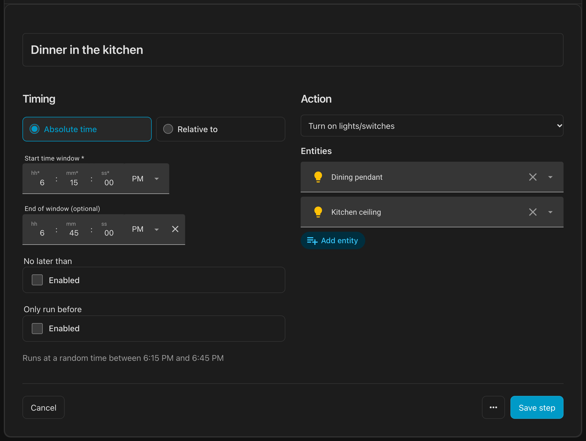
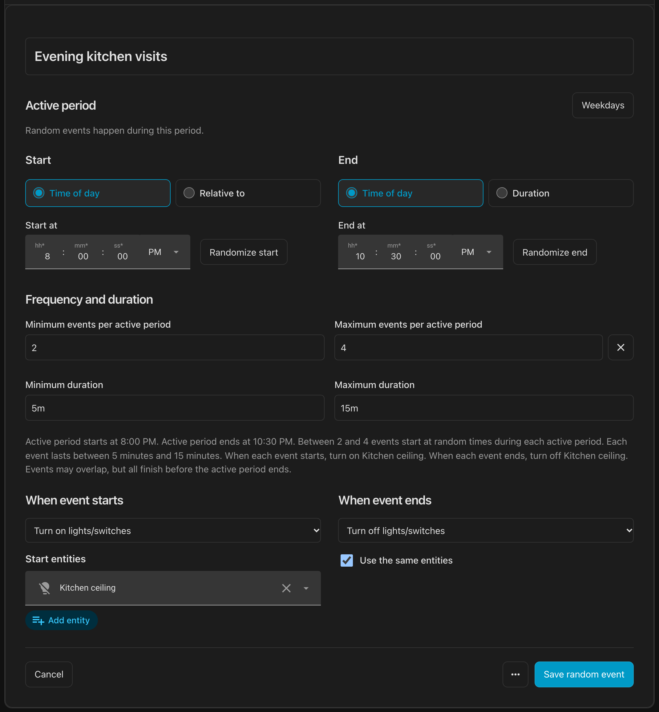
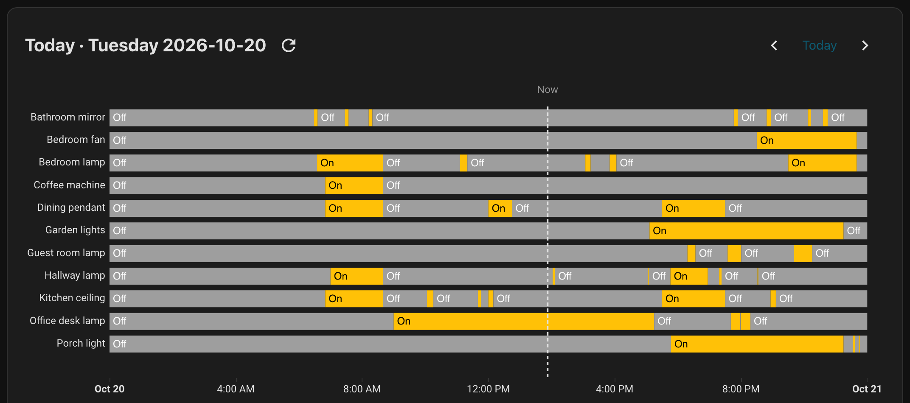
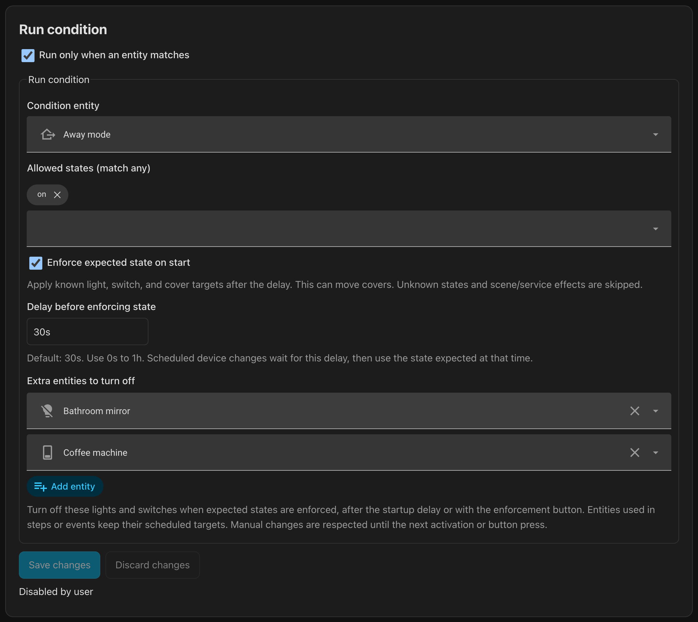
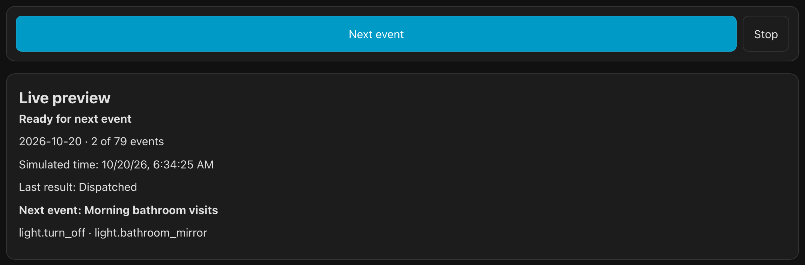
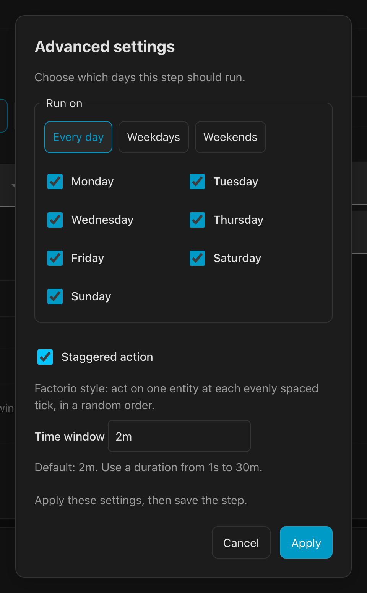

# Occupied


Burglars look for living spaces that look like nobody's home: make sure yours looks occupied!

Occupied is an occupancy simulator for Home Assistant that lets you create schedules for lights, covers, and other entities. But remember the scene in *Home Alone* where Harry knows exactly when each house's lights will come on? Your timers probably shouldn't be that predictable. Therefore, Occupied has built in support for randomness to make your home look lived in.


Occupied also has an easy-to-use GUI, which makes it much easier to set up than traditional automations.

Occupied is the spiritual successor of [Occusim](https://github.com/acockburn/occusim) which is no longer maintained.

# Use cases

* Make your home look occupied while you are away by turning lights on and off at varied times, activating scenes, or opening and closing covers.
* Schedule everyday lighting around sunrise, sunset, or bedtime, with randomized windows instead of the same exact times each day.
* Run a schedule only when your alarm is armed. You can also save power by having Occupied turn off extra lights or switches, such as those in a windowless bathroom.

# Compatibility

Occupied supports the six most recent monthly Home Assistant releases: the current
minor and the five before it. The table lists the exact releases tested in CI.
The oldest minor is tested from its `.0` release; the other lanes use the newest
patch with published matching test fixtures.

At each monthly rollover, one PR adds the new minor and drops the oldest. That PR
updates the HACS minimum, dependency floors, tested container images, and this
table together. Every release includes its supported HA range in the release
notes. Upgrade Home Assistant before installing an Occupied release whose floor
is newer than your HA version.

Integration Python versions follow each supported HA release. The standalone CLI
has its own floor and experimental next-Python lane, described below.

<!-- ha-matrix:start -->
| Home Assistant tested | Python tested | Lane |
| --- | --- | --- |
| 2026.5.0 | 3.14.8 | floor |
| 2026.6.4 | 3.14.8 | window |
| 2026.7.4 | 3.14.8 | window |
| 2026.8.3 | 3.14.8 | window |
| 2026.9.4 | 3.14.8 | window |
| 2026.10.2 | 3.14.8 | newest |
| 2026.10.2 | 3.14.2 | Python floor |

| Standalone Python tested | Lane |
| --- | --- |
| 3.14.2 | floor |
| 3.14.8 | latest |
| 3.15 | experimental |
<!-- ha-matrix:end -->

CI also runs the standalone core suite and all CLI examples on the floor and
latest Python patches listed above, without Home Assistant. The experimental
standalone lane remains nonblocking until both its tests and a fresh wheels-only
dependency resolution pass. Missing published wheels are reported in the CI
summary; test failures and unexpected resolver errors still fail that experimental
job. The Python-floor HA
lane skips one recorder-harness test on CPython versions before 3.14.4; all other
tests are required. Browser smoke tests use isolated, digest-pinned floor and
newest HA containers. Set `HA_IMAGE` to a matrix image to reproduce either lane
with `pnpm run test:browser`.

# Installation

Install through [HACS](https://hacs.xyz/):

1. Open HACS, select the three-dot menu, and choose **Custom repositories**.
2. Add `https://github.com/etnoy/occupied` with the category **Integration**.
3. Find Occupied in HACS and download it, then restart Home Assistant.
4. Go to **Settings → Devices & services → Add integration → Occupied** and create a controller. Choose GUI storage to get started with the editor.
5. Select **Configure** on the integration to open the Occupied panel.

New controllers start with permission disabled, so you can create and preview a schedule before enabling it.

# Usage

Occupied is based around Steps ("turn this light on at that time") or Random Events ("turn a light on and off twice during the day")

## Create a Step

Open Occupied through the integration's **Configure** control (the cog wheel), then choose **Create your first step** in the **Steps** tab.

1. Choose **Absolute time** to run the action at a specific time ("run at 8 AM"), or have it be a random time within a window ("run between 7:30 AM and 8:30 AM")
2. Choose **Relative to** to run the action relative to another event, say "run at sunrise" or "run this step after that step". You add a time offset, like "run 30 minutes before dawn" and optionally make it choose a random time, say "run at a random time between 20 and 40 minutes after sunset"
3. Next, choose an action to run. A simple example is to turn a light on
4. Click on **Save step**.

You can now create more steps and have those steps either be absolute in time, or relative to the previous step



*Dinner lights come on at a different time each evening, within a 30-minute window.*

For more advanced usage like turning on a light at a specific brightness, use **Custom YAML** as the action. See [Custom YAML actions](docs/custom-yaml.md).

## Create a Random Event

Random Events manage a light for both on and off, so you can have a kitchen light that turns on and off for a few times during the day.

1. In the Random tab, choose **Create your first random event** and set its start and end window, for example 18:00–23:00. The window can also start relative to a step or solar event, and end after a fixed or random duration.
2. Set the number of occurrences. Add a maximum to choose a random count within a range, and you can set the minimum to zero so that the event does not happen every day.
3. Set the minimum and maximum duration of each occurrence, such as 5–15 minutes.
4. Choose the entities to turn on and off during each window.
5. Save the random event.



*Short kitchen visits add activity between the main steps. Each visit turns the same light on, then off again.*

## Preview the timeline

Open **Preview** to see how the entities would be turned on and off. This will be a render of the random events within the ranges you chose before, so navigate back and forth during the days to see how those will be randomized.



*Yellow shows when each device is on. Morning routines, random visits, and evening lighting form a different pattern each day.*

## Add a run condition

You probably only want to pretend someone is home when nobody actually is. A run condition lets you do that, say "only run when the alarm is armed" or "only run when my away mode helper is on".

In **Settings → Run condition**, enable **Run only when an entity matches**, pick your entity, and choose the states that should let Occupied run. For an alarm, that could be `armed_away`, or both `armed_away` and `armed_night`.

When the condition stops matching, i.e. when you get home and disarm the alarm, Occupied stops running actions and leaves the lights as they are.

## Enable the integration

When ready, turn on the controller's **Enable** switch in Home Assistant. You will see the **Status** sensor change to **Active** if Occupied has started managing, and **Next event** will update with when the next action will be taken. If the status says **Waiting**, the **Status reason** sensor will tell you why; likely you have a run condition it is waiting on.


# Advanced usages

## Multiple controllers

You can have more than one Occupied controller, each with its own schedule and run condition. For example, one controller can pretend someone is home while you're away, with random lights and a run condition like "only run when the alarm is armed". Another can run all the time and manage your everyday lights, turning window lights on at sunset and off at sunrise. Of course, you can add randomness to those actions as well.

To add another controller, go to **Settings → Devices & services → Add integration → Occupied** again and give it a different name. You can switch between controllers in the Occupied panel, and each has its own **Enable** switch.

## Enforce state when a run condition starts

With run conditions, you can also enforce state. This means that as soon as you leave home, it switches to the expected state without having to wait for the next action.

Under **Settings → Run condition**, enable a run condition, then enable **Enforce expected state on start**.

There is a default setting in **Delay before enforcing state** of `30s`, giving you time to get out of the house before device changes begin.

There is also a button, **Enforce expected state**, that you can press if you accidentally turned on and off some lights and want Occupied to fix that for you.

Use **Extra entities to turn off** for lights and switches that Occupied does not manage but you want turned off when away. This is great for that bathroom light you don't want to forget to turn off when you are away, but you don't want it in a Step or Random Event because the bathroom has no windows.



*When Away mode turns on, enforce the expected state after 30 seconds and switch off extra devices such as the bathroom light and coffee machine.*

## Limit when a step can run

Use the timing controls to combine clock times and solar events:

* **No later than** caps a step's time. For example, turn lights on 90 minutes before sunset, but no later than 18:00. This is useful if you don't want sun-controlled lights to turn on when you are sleeping.
* **Only run before** skips a step unless its time is strictly before the selected boundary. For example, turn lights on at 05:30 only if that is before sunrise plus 90 minutes.

## Try a live preview

In **Preview**, select **Start live preview**. This allows you to preview the schedule on real devices, and you click **Next event** to walk through the simulation step by step.



*Walk through the schedule one event at a time and see which action will run next.*

## Factorio-style lights

In Factorio, a group of lights don't turn on at once when the sun sets, but they have a tiny delay each, creating a beautiful staggered look. You can do this in Occupied by enabling **Staggered action** under **Advanced settings**.

The **Time window** defaults to `2m`, so with four entities over two minutes, actions occur at 30-second intervals.



*Spread the welcome-home lights across two minutes, with a different device order each day.*

See the [staggered-action example](examples/stagger.yaml).

# YAML configuration

While we've put a lot of effort into the GUI, it is still very powerful to do plain old yaml.

## Import and export

Open **Settings** in the controller to edit the YAML directly or load a file, then choose **Save changes** to validate and apply it. If you are an agent wanting to edit Occupied settings, this is the way to do it!

See the [schema reference](docs/schema.md) and [example programs](examples/house.yaml) for more options.

## Use a managed YAML file

To keep configuration in a file instead of GUI storage, put a complete Occupied program at `/config/occupied/house.yaml` on the Home Assistant filesystem, then add this to Home Assistant's `configuration.yaml` and restart:

```yaml
occupied:
  config_file: occupied/house.yaml
```

Each controller has its own permission and schedule so you can have multiple instances controlled by yaml.

With file-based config, you cannot edit programs with the GUI.

## CLI

The standalone `occupied` CLI validates, exports, previews, and renames typed step IDs without importing Home Assistant or executing device services:

```sh
occupied validate examples/house.yaml --date 2026-10-13 --days 7 --timezone Europe/Stockholm --latitude 59.3 --longitude 18.1
occupied preview examples/house.yaml --date 2026-10-13 --seed preview --timezone Europe/Stockholm --latitude 59.3 --longitude 18.1
occupied export examples/house.yaml
occupied rename-id examples/house.yaml step wake_up morning
```

# Development

Use [mise](https://mise.jdx.dev/) with Python's built-in virtual environment and pip; uv is optional:

```sh
mise trust
mise install
mise exec -- python -m ensurepip --upgrade
mise exec -- python -m pip install --upgrade pip
mise exec -- python -m pip install -e . --group dev
pnpm install --frozen-lockfile --ignore-scripts
mise test
pnpm run build
mise lint
mise format
```

`mise test` runs pytest and accepts
additional arguments, for example `mise test tests/core/test_planner.py`. The setup commands
install the dependencies declared in `pyproject.toml`; pip does not reproduce the
exact dependency versions in `uv.lock`.
`mise lint` runs Ruff, ESLint on TypeScript sources and Svelte scripts/templates, and strict TypeScript/Svelte type
checks; `mise format` checks Ruff and Prettier formatting. Use `mise lint-fix` and
`mise format-fix` to apply automatic fixes and rebuild generated frontend files. Install the
Node development dependencies with `pnpm install --frozen-lockfile --ignore-scripts` before running these tasks.
Home Assistant itself depends on the `uv` Python package, so pip installs it inside
the virtual environment even though these development commands use mise and pip.

The environments are defined in `scripts/ha_matrix.toml`. Validate metadata and
generated files with `uv run python scripts/ha_matrix.py check`. Reproduce a
supported environment with `uv run python scripts/ha_matrix.py test --lane floor`
or replace `floor` with a tested HA version; `--lane all` runs all six. Rebuild
hashed requirements with `uv run python scripts/ha_matrix.py compile`, and discover
new releases with `uv run python scripts/ha_matrix.py next`. See the
[monthly rollover runbook](docs/maintenance.md) for the review and release procedure.

For runtime changes, also run
`uv run python scripts/ha_matrix.py test --lane floor -- tests/ha/runtime_soak.py`
and repeat with `--lane newest`. This opt-in soak dispatches every example and
program fixture for 60 days across each Stockholm DST transition, using virtual
services and timers firing one millisecond late. It checks that scheduling remains
active and does not drop previously unhandled events as historical. Startup
history and already completed entries pruned from the bounded journal are expected.

Historical test environments retain the original HA constraints and their recorded
SHA-256 digests. The matrix records one security repair: AnyIO versions below
4.14.2 are replaced by 4.14.2 for [GHSA-82r6-8w77-94w6](https://github.com/advisories/GHSA-82r6-8w77-94w6).
The compiler removes only that vulnerable constraint from its temporary input,
records the replacement in each affected override/header, and keeps all other HA
pins. These are test environments; Occupied does not declare AnyIO as a runtime
requirement. Dependency review, installed-package checks and the full HA suites
remain enabled.

The Python tests are split into `tests/core` (planner, codecs, CLI, and examples) and
`tests/ha` (integration, storage, services, and lifecycle). To run the core suite
without installing Home Assistant:

```sh
uv sync --no-dev --group test-core
uv run --no-dev --group test-core pytest tests/core
```

For the locked environment used by CI, install [uv](https://docs.astral.sh/uv/) and run:

```sh
uv sync --python 3.14 --locked
uv run pytest
uv run ruff check custom_components tests scripts
uv run ruff format --check custom_components tests scripts
pnpm install --frozen-lockfile --ignore-scripts
pnpm run build:check
pnpm run lint
pnpm run typecheck
pnpm run format:check
pnpm test
uv run python scripts/check_release.py
```

The frontend uses Svelte 5 and TypeScript, with `OccupiedPanel` as HA’s custom element and backend controller. Sources live in `custom_components/occupied/frontend/src/`: components are grouped by feature in `lib/components`, with separate folders for controllers, models, actions, services, translations, and utilities. See the [frontend layout](custom_components/occupied/frontend/README.md). HTML lives in `.svelte` components, using template blocks for conditionals and lists. Model and validation logic remain independent of rendering. Preview orchestration lives in `lib/controllers/preview-controller.ts`; subscription lifecycle guards live in `lib/services/subscription.ts`. The editor requires Home Assistant and loads its native selectors and picker before rendering. A small DOM bridge passes object properties and custom events to those HA elements. Controller updates use Svelte's `flushSync` so editor actions can immediately focus newly rendered fields. TypeScript 6 is pinned for compatibility with `svelte-check`'s TypeScript API; strict checks cover both TypeScript and Svelte sources.

Run `pnpm run lint:fix` for automatic lint fixes and `pnpm run format:fix` for formatting.

Run `pnpm run build` after editing `.ts`, `.svelte`, or `.css` files and commit the generated JavaScript under `custom_components/occupied/frontend/dist/` alongside its sources.
